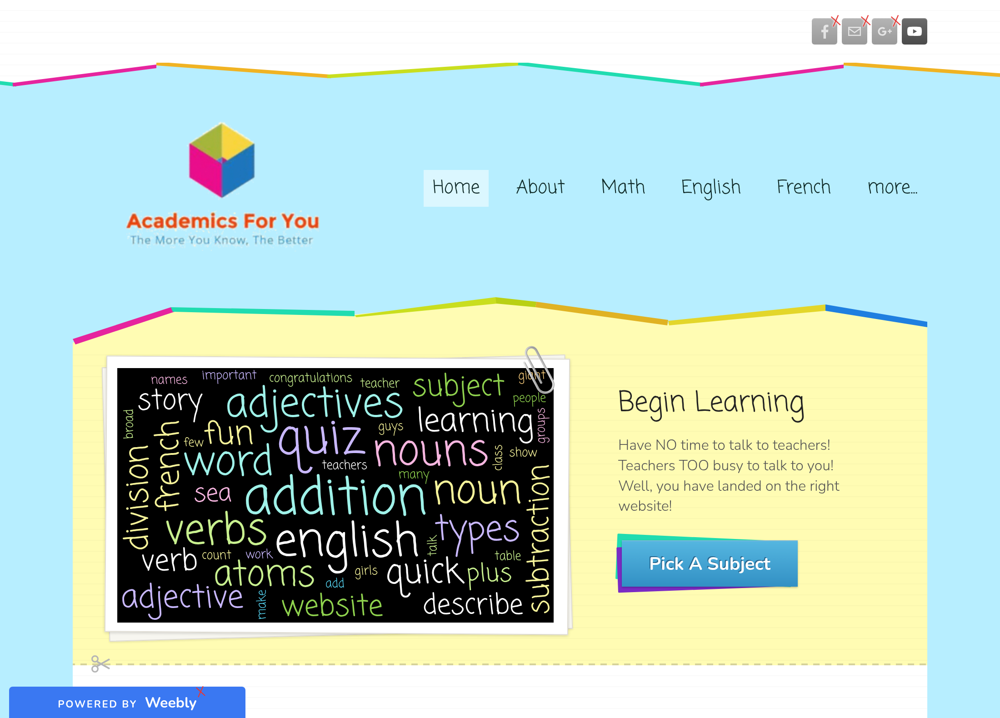

# Academics For You

This was my first website. I made it in 2015, when I was 13, on a free Weebly site, with an [Academics For You YouTube channel](https://www.youtube.com/@academicsforyoucompany9468) to go with it.

The idea was simple: help other kids with school. I wrote lessons on maths, English, French and atoms. I made quizzes where a wrong answer sent you to a "Try Again" page, and I added my videos and Scratch games.

In 2026 Weebly closed in Kenya and the site went offline. The Wayback Machine had never saved it, so the only copy left was inside the Weebly editor. I got it out of there and rebuilt it here, so it can stay online.

## Highlights

- **[The quizzes, built out of links](https://ajv99.github.io/AcademicsForYou/addition-q1.html).** I made quizzes out of plain pages. Each answer is a button: the right one takes you to the next question, and a wrong one takes you to that question's "Try Again" page. The addition and English quizzes take up 23 of the site's 41 pages. **Now that's commitment!**
- **[The Scratch games](https://ajv99.github.io/AcademicsForYou/subtraction.html).** Then I realised one Scratch project could do what all those pages did. I made three and shared them together on 4 October 2015, and they still run inside the site today. Scratch was and still is the OG.
- **[My YouTube lessons](https://ajv99.github.io/AcademicsForYou/addition.html).** "Understanding Addition", "Subtraction", "Multiplication" and "Division", one for each maths lesson.
- **[The pitch](https://ajv99.github.io/AcademicsForYou/).** "Have NO time to talk to teachers! Teachers TOO busy to talk to you! Well, you have landed on the right website!"
- **[The superscript workaround](https://ajv99.github.io/AcademicsForYou/atoms.html).** The editor couldn't write powers, so I made a picture of "1¹" and put a big red CAUTION / WARNING above it to explain.
- **[The story challenge](https://ajv99.github.io/AcademicsForYou/english-bonus.html).** Write a story, email it in, and I'd mark it and send it back "as fast as we can".

## What I kept

Every word I wrote at 13 is here as I wrote it: the colours, the sizes, the underlines, the capital letters and the typos. "Cattlefish" stays.

The look is the same too: lined paper, zig-zag paper strips, the paperclip, the scissors and the hills at the bottom. It was a Weebly theme, so I redrew it by hand instead of copying it.

## What I changed

- A few pictures belonged to other people, so I replaced them. The home page now has a word cloud made from the site's own words, and the "Congrats!" at the end of the quizzes is drawn in code.
- Some quiz buttons went to the wrong page. I fixed those, and nothing else.
- The atoms pages showed Khan Academy articles. They now link to the articles instead.
- A French widget, one quiz and the contact forms used services that no longer exist. Their spots are marked on the page.
- The "Powered by Weebly" tab in the corner is back, sort of. Hover over it.

The site's motto was "The More You Know, The Better." Thirteen-year-old me was onto something.

## Running it

It's plain HTML. `python3 build.py` rebuilds the pages from the text in `build.py`, and `python3 -m http.server` serves them at http://localhost:8000.
